# java精品项目-基于ssm的个人博客系统

> 🎓 **计算机毕业设计 · java精品项目-基于ssm的个人博客系统**
>
> 本仓库只放**项目介绍 + 运行截图**（截图是站点带水印的原图，存在仓库 `images/` 里）。
>
> 👉 **完整可运行源码 / 数据库脚本 / 部署文档：[点我获取](https://geekcode.top/archives/java%E7%B2%BE%E5%93%81%E9%A1%B9%E7%9B%AE-%E5%9F%BA%E4%BA%8Essm%E7%9A%84%E4%B8%AA%E4%BA%BA%E5%8D%9A%E5%AE%A2%E7%B3%BB%E7%BB%9F?utm_source=github)**
>
> 💬 咨询微信：**ir9372**　|　🌐 更多项目：[极客代码 geekcode.top](https://geekcode.top/?utm_source=github)
>
> 📌 项目详情页：<https://geekcode.top/archives/java%E7%B2%BE%E5%93%81%E9%A1%B9%E7%9B%AE-%E5%9F%BA%E4%BA%8Essm%E7%9A%84%E4%B8%AA%E4%BA%BA%E5%8D%9A%E5%AE%A2%E7%B3%BB%E7%BB%9F?utm_source=github>

<table><td width="230" align="center"> <b>扫码加微信 ir9372</b></td><td valign="middle">📦 源码 = 项目介绍 + 全部运行截图 + 数据库 + 部署文档 👉 点上方任意截图，直接跳到 <b>极客代码 geekcode.top</b> 详情页</td></table>

---

<h1>java精品项目-基于ssm的个人博客系统</h1>
<h2>项目概述</h2>

本项目名为“java精品项目-基于ssm的个人博客系统”，旨在构建一个轻量级、高性能的个人内容发布与管理平台。系统采用 Spring Boot 作为核心框架，结合 MyBatis 进行数据持久化操作，利用 Thymeleaf 模板引擎实现服务端页面渲染。通过集成 Redis 缓存机制与 Druid 连接池，显著提升了系统的响应速度与数据库访问效率。此外，引入 WebSocket 技术以支持实时通信功能，增强了用户交互体验。该项目主要面向个人博主或小型内容创作者，提供稳定可靠的技术底座，适用于对性能有一定要求且偏好传统 MVC 架构的开发场景。

<h2>技术架构</h2>

本系统采用典型的 B/S 架构，后端基于 Java 语言开发，前端视图层使用 Thymeleaf 模板引擎。

<strong>核心技术选型：</strong>

<ol>
<li><strong>Spring Boot</strong>: 作为基础框架，简化配置流程，提供自动装配能力，快速搭建 Web 应用环境。依赖 <code>spring-boot-starter-web</code> 处理 HTTP 请求。</li>
<li><strong>MyBatis</strong>: 用于 ORM 映射，通过 <code>mybatis-spring-boot-starter</code> 集成，灵活管理 SQL 语句，适合复杂查询场景。</li>
<li><strong>Druid</strong>: 阿里巴巴开源的高性能数据库连接池，监控数据库访问状态，提升并发处理能力。</li>
<li><strong>Redis</strong>: 通过 <code>spring-boot-starter-data-redis</code> 集成，用于缓存热点数据（如文章列表、用户会话），减轻数据库压力。</li>
<li><strong>WebSocket</strong>: 支持双向实时通信，可能用于消息推送或在线状态同步。</li>
<li><strong>日志体系</strong>: 采用 SLF4J + Log4j2 组合，包含 <code>log4j-slf4j-impl</code>, <code>log4j-core</code> 等组件，确保日志记录的规范性与高效性。</li>
</ol>

<strong>数据库设计要点：</strong>
虽然具体表结构未在上下文中展示，但基于博客系统通用逻辑，预计包含文章表、用户表、评论表及标签分类表。MyBatis 负责实体类与数据库表的映射，Redis 负责高频读取数据的缓存存储。

<h2>功能模块</h2>

根据提供的截图列表（系统运行界面1至14）及技术栈信息，系统主要包含以下功能模块：

<strong>前台用户端：</strong>
由于项目标记为“无前台导航菜单”、“无前台路由”，且截图均标注为 (front)，推测所有可见界面均为前端展示层。基于个人博客系统的常规功能及现有截图数量，主要功能包括：

<ol>
<li><strong>首页展示</strong>: 显示最新发布的文章摘要、推荐内容及站点公告。</li>
<li><strong>文章详情浏览</strong>: 展示单篇文章的完整内容、发布时间、作者信息及关联标签。</li>
<li><strong>分类/标签检索</strong>: 用户可通过特定分类或标签筛选相关文章列表。</li>
<li><strong>评论互动</strong>: 允许用户对文章发表评论，并查看历史评论记录。</li>
<li><strong>实时消息通知</strong>: 基于 WebSocket 技术，可能在后台有新评论或系统更新时向在线用户推送提示。</li>
</ol>

<strong>后台管理端：</strong>
项目明确标识“是否有后台: 否”、“无后台路由”。因此，本系统不包含独立的后台管理界面。内容的发布与管理可能通过直接操作数据库或通过未公开的 API 接口完成，不在当前 UI 范围内体现。

<h2>用户角色与权限</h2>

鉴于项目明确指出“是否有后台: 否”且无个人中心菜单，系统权限模型较为简单，主要分为以下两类隐式角色：

<ol>
<li>
<strong>访客（游客）</strong>：

<ul>
<li><strong>可访问功能</strong>：浏览首页、查看文章详情、阅读评论内容。</li>
<li><strong>限制</strong>：无法发布评论或进行其他写操作（除非系统设计允许匿名评论，但通常需登录）。</li>
</ul>
</li>
<li>
<strong>注册用户/博主</strong>：

<ul>
<li><strong>可访问功能</strong>：除访客权限外，若系统支持登录（尽管无显式个人中心菜单，但 Redis 会话管理暗示可能存在身份验证），可进行评论发表。</li>
<li><strong>注意</strong>：由于无后台管理端，内容的创建与维护不由普通用户通过网页界面完成，而是由开发者或管理员在服务器端直接处理。</li>
</ul>
</li>
</ol>

<em>注：因缺乏具体的权限控制代码上下文及后台入口，以上角色划分基于典型博客系统逻辑推导，实际系统中若未实现登录模块，则仅存在“访客”单一角色。</em>

<h2>项目特色与创新点</h2>
<ol>
<li><strong>高性能缓存策略</strong>：深度集成 Redis，将频繁访问的博客元数据和文章内容存入缓存，有效降低 MySQL 数据库负载，提升页面加载速度。</li>
<li><strong>实时交互能力</strong>：引入 WebSocket 技术，突破了传统 HTTP 请求-响应模式的局限性，为未来扩展即时通讯或动态更新功能奠定基础。</li>
<li><strong>稳健的数据访问层</strong>：选用 Druid 连接池替代默认 HikariCP 或其他简单连接池，提供了更丰富的数据库监控指标和更强的异常处理能力，保障系统在长期运行下的稳定性。</li>
<li><strong>简洁的服务端渲染</strong>：采用 Thymeleaf 而非前后端分离架构，减少了前端构建复杂度，SEO 友好度更高，适合个人博客这类以内容展示为主的场景。</li>
</ol>
<h2>部署环境</h2>

为确保系统正常运行，需准备以下软件环境：

<ol>
<li><strong>Java Development Kit (JDK)</strong>: 建议版本 JDK 8 或 JDK 11+，以兼容 Spring Boot 及相关依赖。</li>
<li><strong>数据库</strong>: MySQL 5.7 或 8.0+，需安装并配置好实例，创建对应数据库 schema。</li>
<li><strong>缓存服务</strong>: Redis Server 5.0+，需启动并开放端口供应用连接。</li>
<li><strong>Web 容器</strong>: 内置 Tomcat（由 spring-boot-starter-web 提供），无需额外安装外部 Servlet 容器。</li>
<li><strong>构建工具</strong>: Maven 3.6+，用于依赖管理和项目打包。</li>
<li><strong>操作系统</strong>: Linux (CentOS/Ubuntu) 或 Windows Server，生产环境推荐使用 Linux。</li>
</ol>
<h2>五、技术特性</h2>
<ul>
<li>服务端模板渲染（Thymeleaf）</li>
<li>使用 Redis 缓存提升系统性能</li>
</ul>
<h2>六、功能模块截图</h2>
<h3>前台用户端</h3>
<h4>系统运行界面1</h4>

<a href="https://geekcode.top/archives/java%E7%B2%BE%E5%93%81%E9%A1%B9%E7%9B%AE-%E5%9F%BA%E4%BA%8Essm%E7%9A%84%E4%B8%AA%E4%BA%BA%E5%8D%9A%E5%AE%A2%E7%B3%BB%E7%BB%9F?utm_source=github" title="查看完整源码">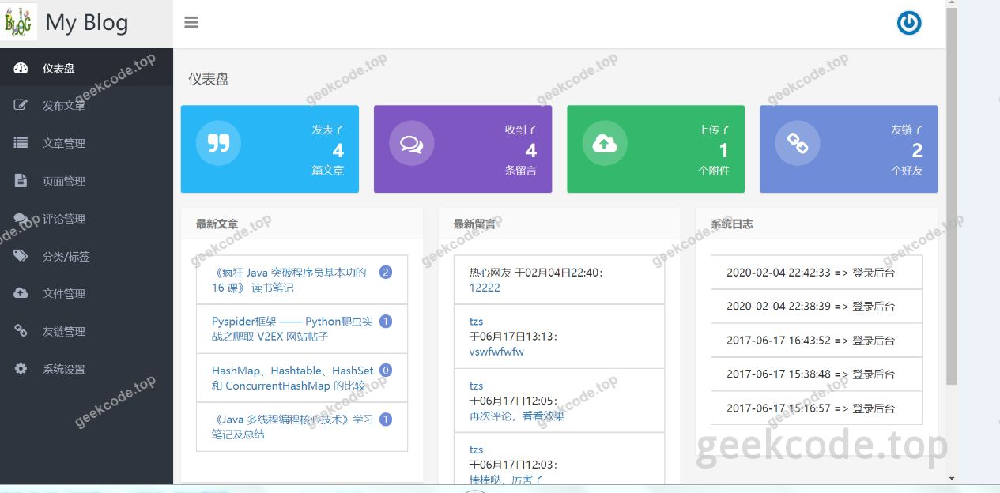</a>

<h4>系统运行界面2</h4>

<a href="https://geekcode.top/archives/java%E7%B2%BE%E5%93%81%E9%A1%B9%E7%9B%AE-%E5%9F%BA%E4%BA%8Essm%E7%9A%84%E4%B8%AA%E4%BA%BA%E5%8D%9A%E5%AE%A2%E7%B3%BB%E7%BB%9F?utm_source=github" title="查看完整源码">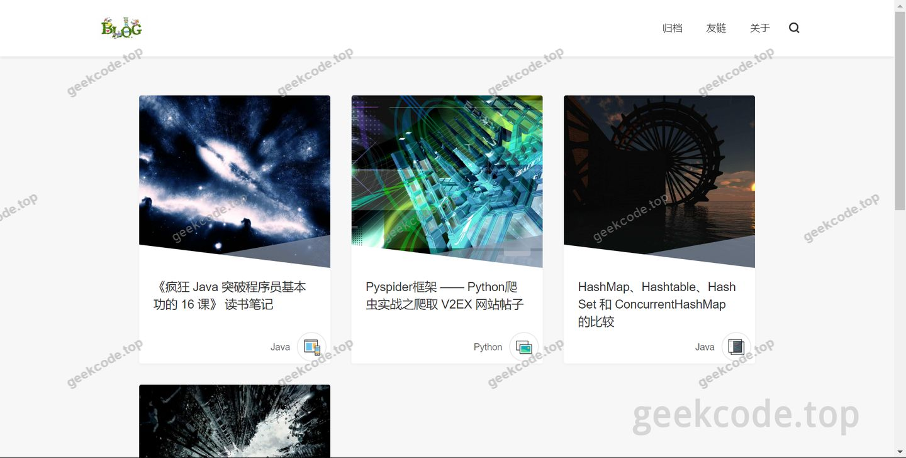</a>

<h4>系统运行界面3</h4>

<a href="https://geekcode.top/archives/java%E7%B2%BE%E5%93%81%E9%A1%B9%E7%9B%AE-%E5%9F%BA%E4%BA%8Essm%E7%9A%84%E4%B8%AA%E4%BA%BA%E5%8D%9A%E5%AE%A2%E7%B3%BB%E7%BB%9F?utm_source=github" title="查看完整源码">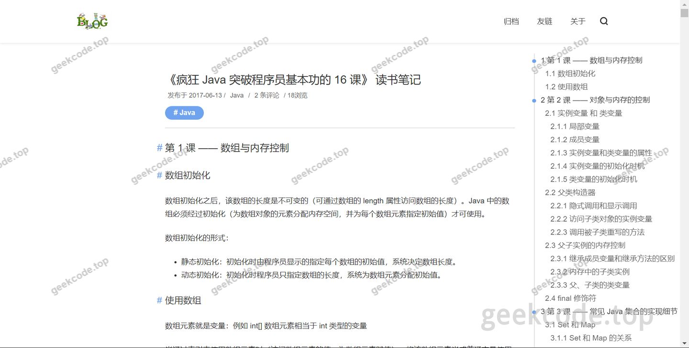</a>

<h4>系统运行界面4</h4>

<a href="https://geekcode.top/archives/java%E7%B2%BE%E5%93%81%E9%A1%B9%E7%9B%AE-%E5%9F%BA%E4%BA%8Essm%E7%9A%84%E4%B8%AA%E4%BA%BA%E5%8D%9A%E5%AE%A2%E7%B3%BB%E7%BB%9F?utm_source=github" title="查看完整源码">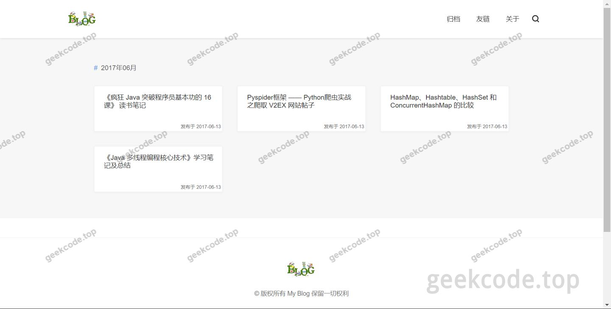</a>

<h4>系统运行界面5</h4>

<a href="https://geekcode.top/archives/java%E7%B2%BE%E5%93%81%E9%A1%B9%E7%9B%AE-%E5%9F%BA%E4%BA%8Essm%E7%9A%84%E4%B8%AA%E4%BA%BA%E5%8D%9A%E5%AE%A2%E7%B3%BB%E7%BB%9F?utm_source=github" title="查看完整源码">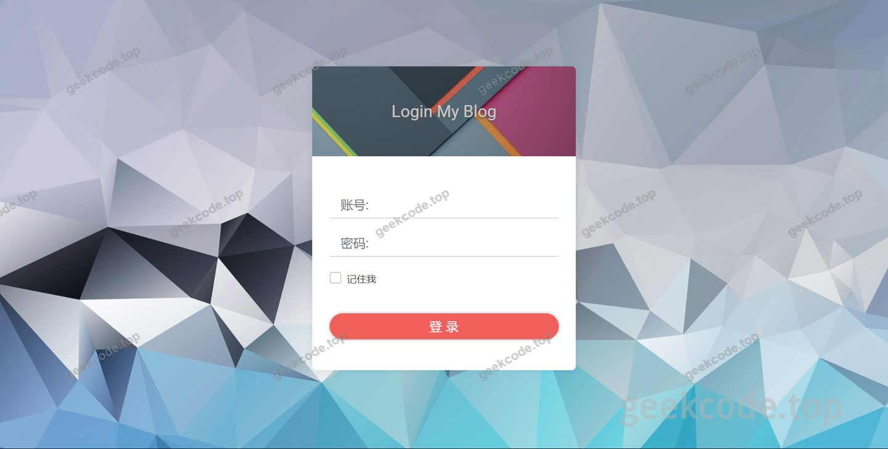</a>

<h4>系统运行界面6</h4>

<a href="https://geekcode.top/archives/java%E7%B2%BE%E5%93%81%E9%A1%B9%E7%9B%AE-%E5%9F%BA%E4%BA%8Essm%E7%9A%84%E4%B8%AA%E4%BA%BA%E5%8D%9A%E5%AE%A2%E7%B3%BB%E7%BB%9F?utm_source=github" title="查看完整源码">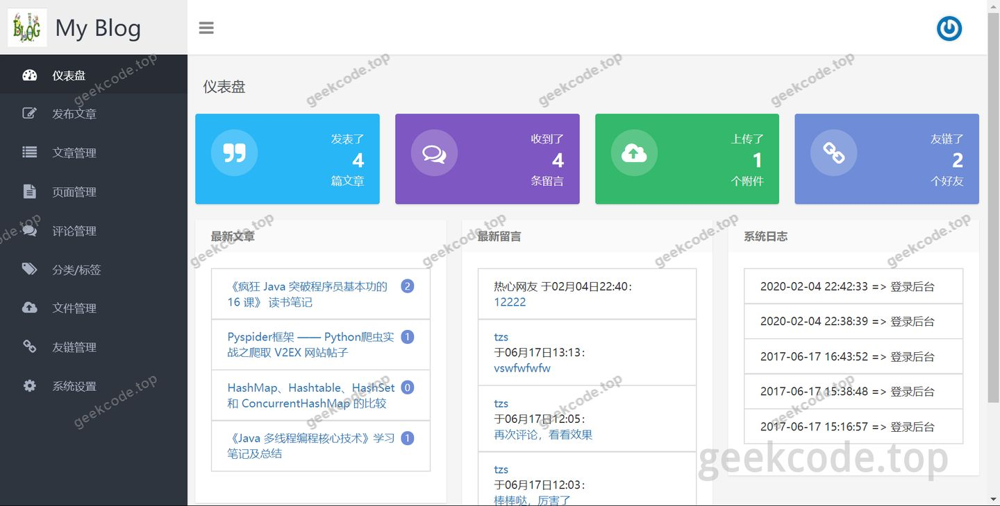</a>

<h4>系统运行界面7</h4>

<a href="https://geekcode.top/archives/java%E7%B2%BE%E5%93%81%E9%A1%B9%E7%9B%AE-%E5%9F%BA%E4%BA%8Essm%E7%9A%84%E4%B8%AA%E4%BA%BA%E5%8D%9A%E5%AE%A2%E7%B3%BB%E7%BB%9F?utm_source=github" title="查看完整源码">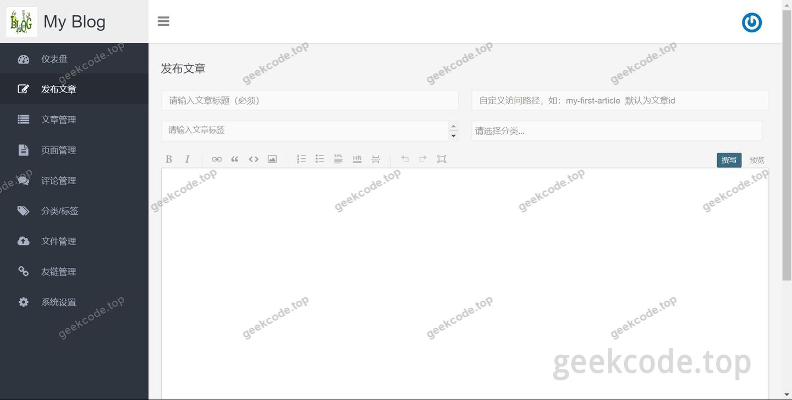</a>

<h4>系统运行界面8</h4>

<a href="https://geekcode.top/archives/java%E7%B2%BE%E5%93%81%E9%A1%B9%E7%9B%AE-%E5%9F%BA%E4%BA%8Essm%E7%9A%84%E4%B8%AA%E4%BA%BA%E5%8D%9A%E5%AE%A2%E7%B3%BB%E7%BB%9F?utm_source=github" title="查看完整源码">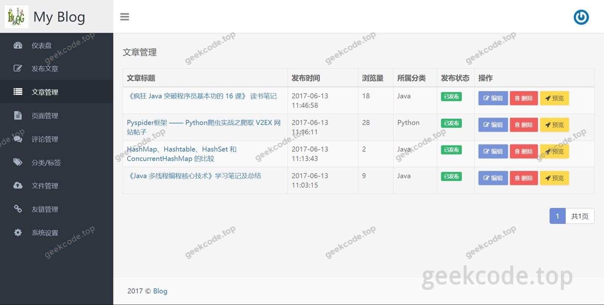</a>

<h4>系统运行界面9</h4>

<a href="https://geekcode.top/archives/java%E7%B2%BE%E5%93%81%E9%A1%B9%E7%9B%AE-%E5%9F%BA%E4%BA%8Essm%E7%9A%84%E4%B8%AA%E4%BA%BA%E5%8D%9A%E5%AE%A2%E7%B3%BB%E7%BB%9F?utm_source=github" title="查看完整源码">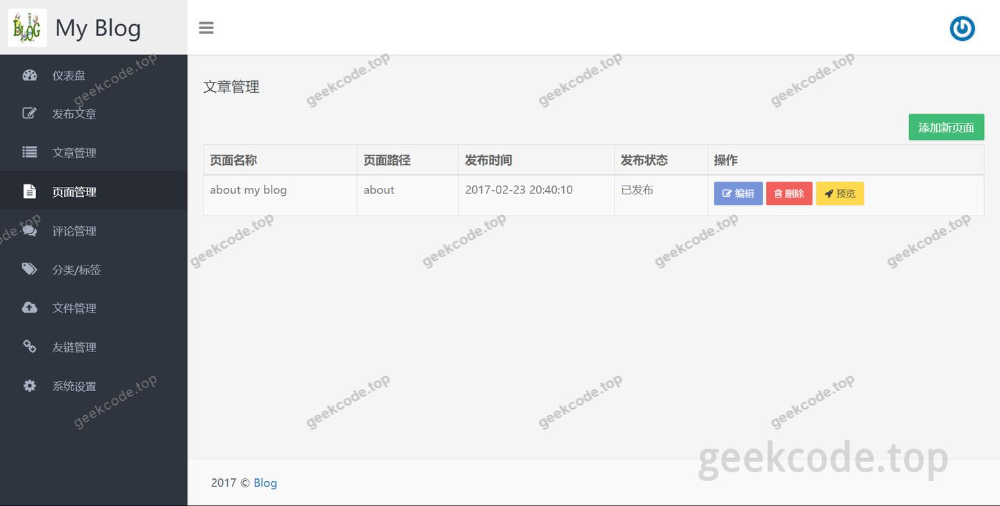</a>

<h4>系统运行界面10</h4>

<a href="https://geekcode.top/archives/java%E7%B2%BE%E5%93%81%E9%A1%B9%E7%9B%AE-%E5%9F%BA%E4%BA%8Essm%E7%9A%84%E4%B8%AA%E4%BA%BA%E5%8D%9A%E5%AE%A2%E7%B3%BB%E7%BB%9F?utm_source=github" title="查看完整源码">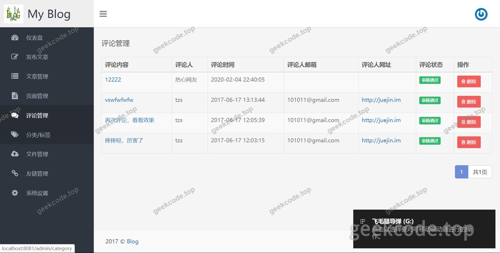</a>

<h4>系统运行界面11</h4>

<a href="https://geekcode.top/archives/java%E7%B2%BE%E5%93%81%E9%A1%B9%E7%9B%AE-%E5%9F%BA%E4%BA%8Essm%E7%9A%84%E4%B8%AA%E4%BA%BA%E5%8D%9A%E5%AE%A2%E7%B3%BB%E7%BB%9F?utm_source=github" title="查看完整源码">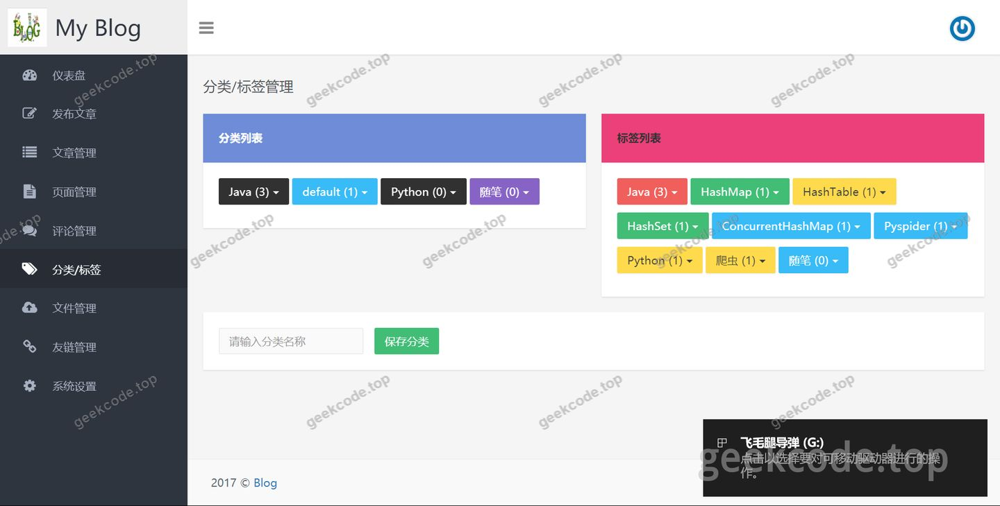</a>

<h4>系统运行界面12</h4>

<a href="https://geekcode.top/archives/java%E7%B2%BE%E5%93%81%E9%A1%B9%E7%9B%AE-%E5%9F%BA%E4%BA%8Essm%E7%9A%84%E4%B8%AA%E4%BA%BA%E5%8D%9A%E5%AE%A2%E7%B3%BB%E7%BB%9F?utm_source=github" title="查看完整源码">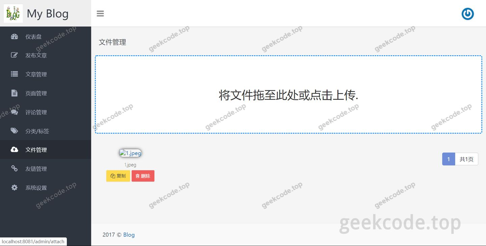</a>

<h4>系统运行界面13</h4>

<a href="https://geekcode.top/archives/java%E7%B2%BE%E5%93%81%E9%A1%B9%E7%9B%AE-%E5%9F%BA%E4%BA%8Essm%E7%9A%84%E4%B8%AA%E4%BA%BA%E5%8D%9A%E5%AE%A2%E7%B3%BB%E7%BB%9F?utm_source=github" title="查看完整源码">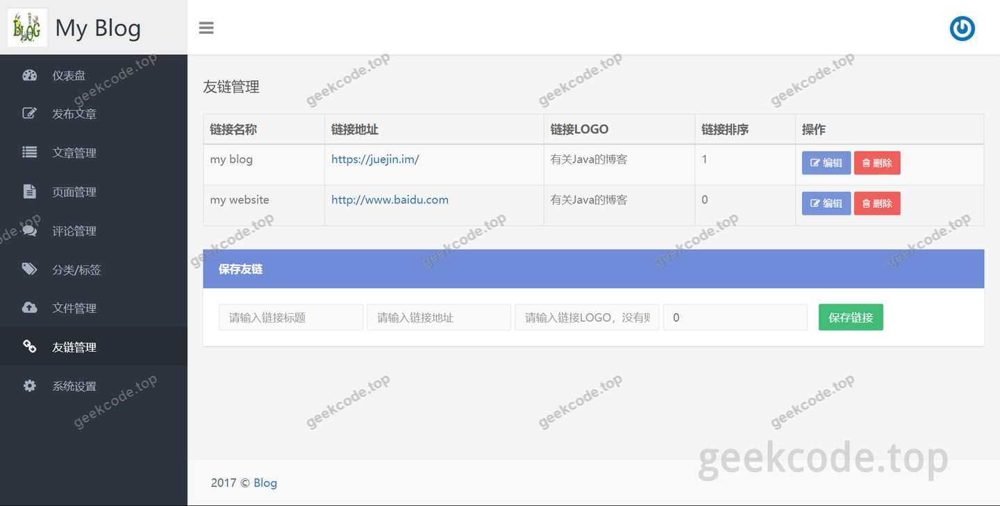</a>

<h4>系统运行界面14</h4>

<a href="https://geekcode.top/archives/java%E7%B2%BE%E5%93%81%E9%A1%B9%E7%9B%AE-%E5%9F%BA%E4%BA%8Essm%E7%9A%84%E4%B8%AA%E4%BA%BA%E5%8D%9A%E5%AE%A2%E7%B3%BB%E7%BB%9F?utm_source=github" title="查看完整源码">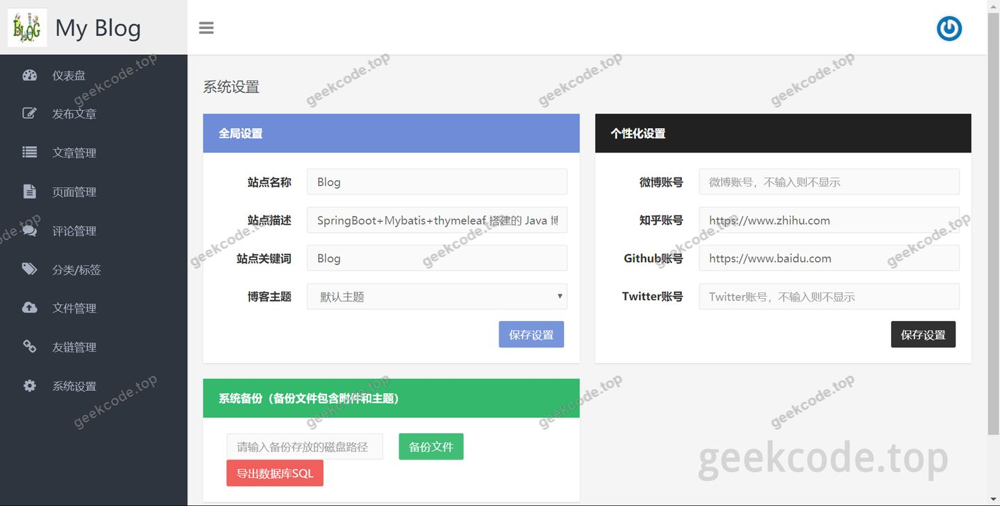</a>

---

## 获取完整源码

| 项目 | 说明 |
| --- | --- |
| 项目名 | java精品项目-基于ssm的个人博客系统 |
| 运行截图 | 本文 14 张（站点带水印原图，仓库 `images/` 目录） |
| 完整源码 | [https://geekcode.top/archives/java%E7%B2%BE%E5%93%81%E9%A1%B9%E7%9B%AE-%E5%9F%BA%E4%BA%8Essm%E7%9A%84%E4%B8%AA%E4%BA%BA%E5%8D%9A%E5%AE%A2%E7%B3%BB%E7%BB%9F?utm_source=github](https://geekcode.top/archives/java%E7%B2%BE%E5%93%81%E9%A1%B9%E7%9B%AE-%E5%9F%BA%E4%BA%8Essm%E7%9A%84%E4%B8%AA%E4%BA%BA%E5%8D%9A%E5%AE%A2%E7%B3%BB%E7%BB%9F?utm_source=github) |
| 咨询微信 | **ir9372**（备注：jingpin-yuanma） |
| 更多项目 | [极客代码 geekcode.top](https://geekcode.top/?utm_source=github) |

> 需要源码、部署、改配置、跑不起来等问题，加微信 ir9372 沟通，说明项目名即可。
